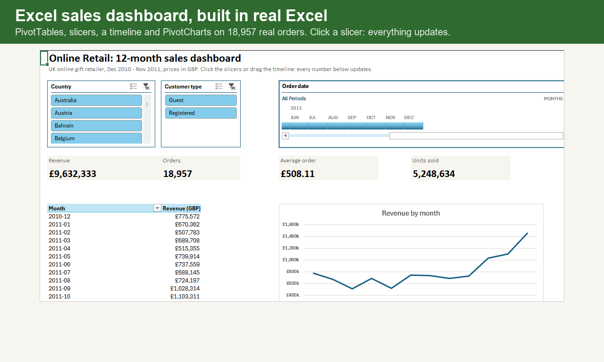
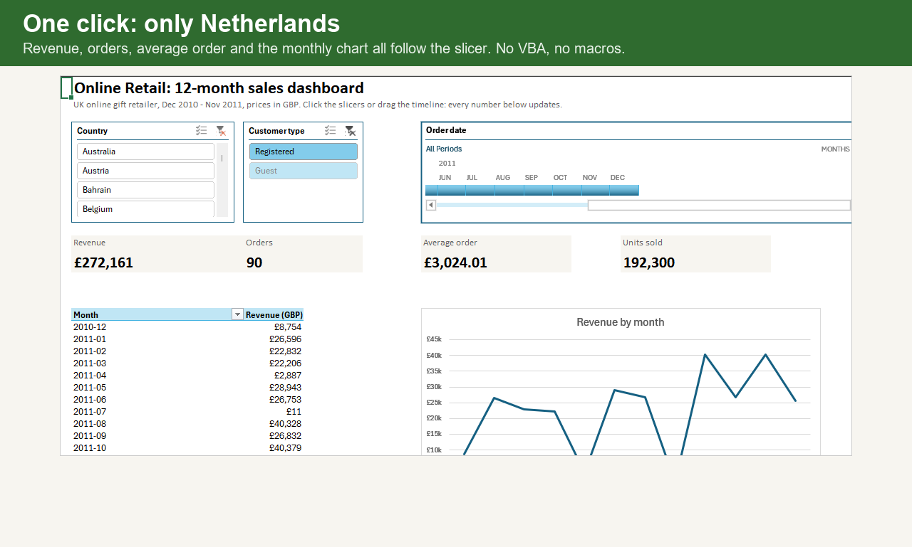
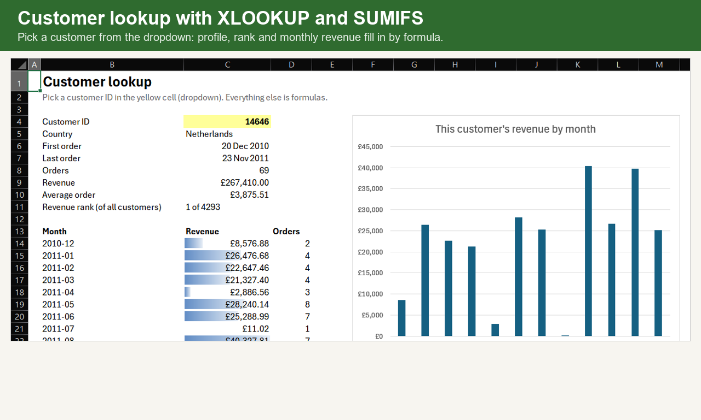

# Excel sales dashboard: PivotTables, slicers and XLOOKUP

A one-file Excel dashboard on 12 months of real orders from a UK online gift retailer. Click a slicer or drag the timeline and every number and chart updates. No VBA, no macros, no add-ins.

**Deliverable:** [`deliverable/Online_Retail_Sales_Dashboard.xlsx`](deliverable/Online_Retail_Sales_Dashboard.xlsx)



## What is inside

| Sheet | Contents |
|---|---|
| Dashboard | 4 KPI tiles (revenue, orders, average order, units), revenue by month, top 10 countries, an orders heatmap by weekday and hour, top 10 products. Slicers for country and customer type, and a timeline for order date. |
| Customer_Lookup | Pick a customer ID from a dropdown. Profile, revenue rank and monthly revenue fill in with XLOOKUP, SUMIFS and COUNTIFS, with data bars and a chart. |
| Invoices | 18,957 orders, one row each, as an Excel Table (the source of every pivot) |
| Products | 3,897 products with units, revenue and average price |
| Customers | 4,293 registered customers with first and last order, orders and revenue |
| Notes | Source and licence, how to refresh, what to keep in mind, and every row removed from the raw file |

Picking **Netherlands** in the Country slicer, for example, turns the tiles into £272,161 from 90 orders:





## Source

[Online Retail](https://archive.ics.uci.edu/dataset/352/online+retail), UCI Machine Learning Repository, Daqing Chen (2015), licence CC BY 4.0. A UK-based online gift shop; many of its customers are wholesalers. Prices are in GBP. The raw file (541,909 order lines) is not stored here because of its size.

## What was removed

| Rule | Lines removed |
|---|---:|
| Outside Dec 2010 - Nov 2011 (keeps 12 full months; the file stops on 9 Dec 2011) | 25,525 |
| Cancelled invoices (number starts with C) | 8,928 |
| Quantity zero or negative (stock adjustments) | 1,306 |
| Unit price zero or negative | 1,157 |
| Not a product (postage, fees, manual lines, samples) | 2,298 |
| Exact duplicate lines | 4,943 |

497,752 lines remain, grouped into 18,957 orders. The same table is in the workbook's Notes sheet and in `data/clean/change_log.csv`.

## What the dashboard shows

- **Revenue:** £9.63m over 12 months. November 2011 is the best month (£1.45m) and February the weakest (£0.51m); sales climb from September, in line with Christmas buying.
- **Countries:** the UK brings 84.6% of revenue. The Netherlands and Ireland (EIRE) are next.
- **Timing:** orders peak around midday. There are no orders on Saturdays in this data.
- **Guests:** 1,331 orders (£1.41m) have no customer ID. They are real sales but cannot be tied to a customer.
- **Customers:** the top 10 registered customers bring 16.7% of registered revenue.

These describe this one shop's public data, not online retail in general.

## How it was built

The data is prepared in Python (pandas) so every removed line is counted. Excel itself then builds the workbook through COM automation: the PivotTables, slicers, timeline, PivotCharts and formulas are native Excel objects, the same as ones made by hand, and refresh with Data > Refresh All. I checked the KPI tiles, the country ranking and the Netherlands slicer result against pandas.

```bash
pip install -r ../requirements.txt pywin32
python src/prepare.py path/to/online_retail.csv   # writes data/clean/*.csv
python src/build_dashboard.py                      # needs Windows + Excel 2019/365 (XLOOKUP)
pytest tests                                       # 5 checks on the cleaned data
```

## Files

```
data/clean/      invoices.csv, products.csv, customers.csv, change_log.csv
deliverable/     the Excel dashboard
docs/            screenshots
src/             prepare.py, build_dashboard.py
tests/           test_data.py
```
